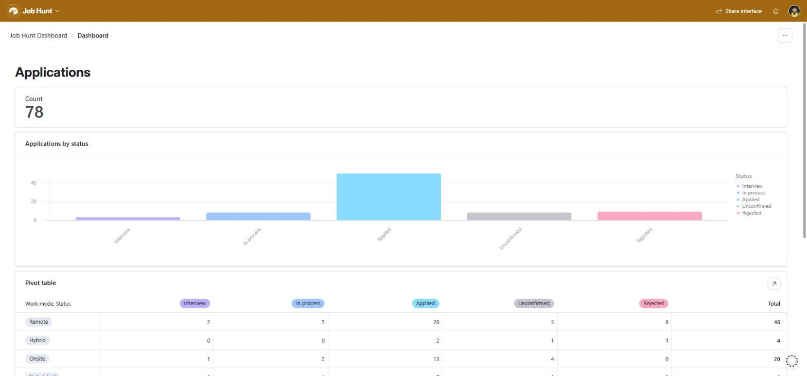
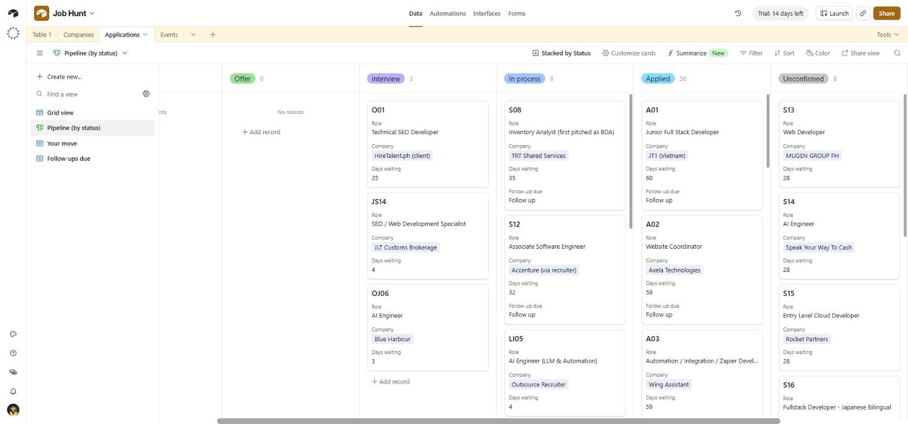
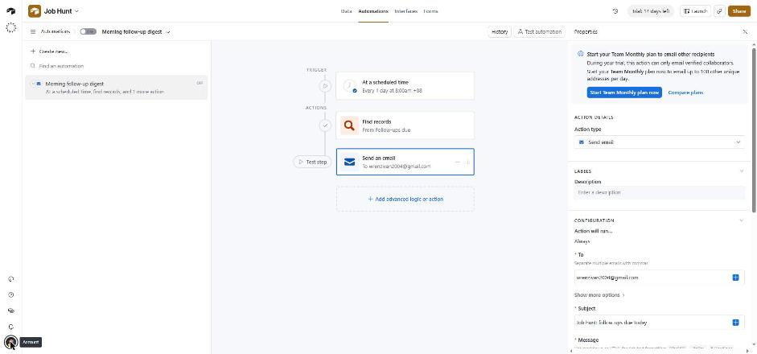
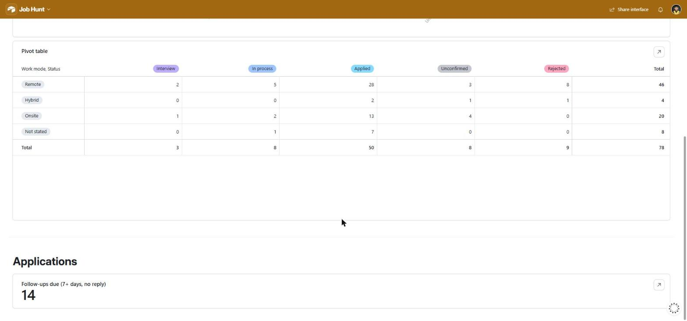

# Job Hunt in Airtable

My job search runs out of a JSON tracker (one row per application: company, role, date sent,
status, pay, setup, latest reply, what I still owe them). This repo turns that tracker into an
Airtable base I actually use day to day: linked tables, a Kanban pipeline, a "your move" list,
a follow-up flag, a morning email and a small dashboard.

I hadn't used Airtable before this. I built it to learn the platform properly, with Claude
Code's help on the script.



## What's in the base

**Tables** (created by `sync.py` through the Meta API)

| Table | Fields | Links |
|---|---|---|
| Companies | Name, Channel, No. of applications (count), Status (rollup) | ← Applications |
| Applications | Tracker ID, Role, Sent, Status, Pay PHP per month, Pay as listed, Setup, Work mode, Channel, Latest, Your move, Days waiting, Follow-up due | → Company, ← Events |
| Events | What, Date | → Application |

**Formulas** (added in the Airtable UI; the API can't create formula or rollup fields)

```
Days waiting   IF({Sent}, DATETIME_DIFF(TODAY(), {Sent}, 'days'))
Follow-up due  IF(AND(OR({Status} = 'Applied', {Status} = 'In process'),
                      {Days waiting} >= 7), 'Follow up', '')
```

**Views on Applications**

- *Pipeline (by status)*: Kanban stacked by Status, cards show role, company, days waiting and the follow-up flag
- *Your move*: only rows where I owe the next step
- *Follow-ups due*: only flagged rows, longest wait first



**Automation: Morning follow-up digest**

Every day at 8:00 AM (Manila time): *Find records* in the Follow-ups due view, then *Send an email*
to me with those records as a table (ID, role, sent, status, company, channel, latest, days waiting).



**Interface: Job Hunt Dashboard**

Total applications, a bar chart by status, a work mode × status pivot, and a follow-ups count
that opens the list of flagged applications when you click it.



## `sync.py`

Reads the tracker JSON and makes the base match it.

1. **Schema**: creates Companies, Applications and Events if missing, adds any missing fields,
   then adds the link fields. Links come last because a link field needs the other table's id.
2. **Upserts**: companies merge on *Name*, applications on *Tracker ID*, events on *What*,
   using `performUpsert` so nothing is ever duplicated.
3. **Safe updates**: empty values are dropped before sending, so a re-sync never blanks a field
   someone filled in by hand in Airtable. The one exception is *Your move*, which is cleared on
   purpose when the to-do is done.

Running it twice in a row changes nothing the second time: after two runs the base still has
78 companies, 78 applications and 3 events.

### Rate limits and errors

Airtable allows 5 requests per second per base and returns `429` past that, with a 30-second
penalty. The client:

- spaces every call at least 0.22 s apart (under 5/s)
- sends records in batches of 10, the API maximum per write
- waits 30 s on a `429`, then retries
- retries `5xx` responses with exponential backoff (1, 2, 4, 8, 16, 32 s)
- stops with the status code and the first 300 characters of the body on any other error

### Setup

```bash
pip install requests
```

Create a personal access token at airtable.com/create/tokens with the scopes
`data.records:read`, `data.records:write`, `schema.bases:read` and `schema.bases:write`,
limited to the one base. Then put it in `AIRTABLE_TOKEN`. The script reads it from the
environment and never takes it as an argument.

```bash
python sync.py --base appXXXXXXXXXXXXXX applications.json --dry-run   # prints the plan, writes nothing
python sync.py --base appXXXXXXXXXXXXXX applications.json
```

The input is a JSON array of objects with these keys: `id`, `company`, `role`, `sent`
(YYYY-MM-DD), `status`, `channel`, and optionally `pay`, `pay_php`, `setup`, `work_mode`,
`next_step`, `your_move`, `due`, `due_what`.

## What I'd add next

- Run the sync on a schedule, so the base follows the tracker without me starting it
- A form for logging a new application straight into Airtable
- Writing replies back from Airtable to the tracker, so either side can be edited
